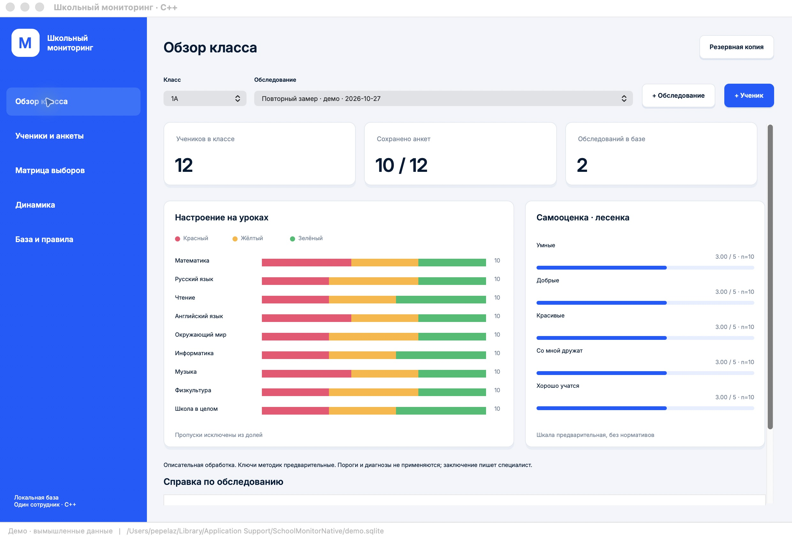
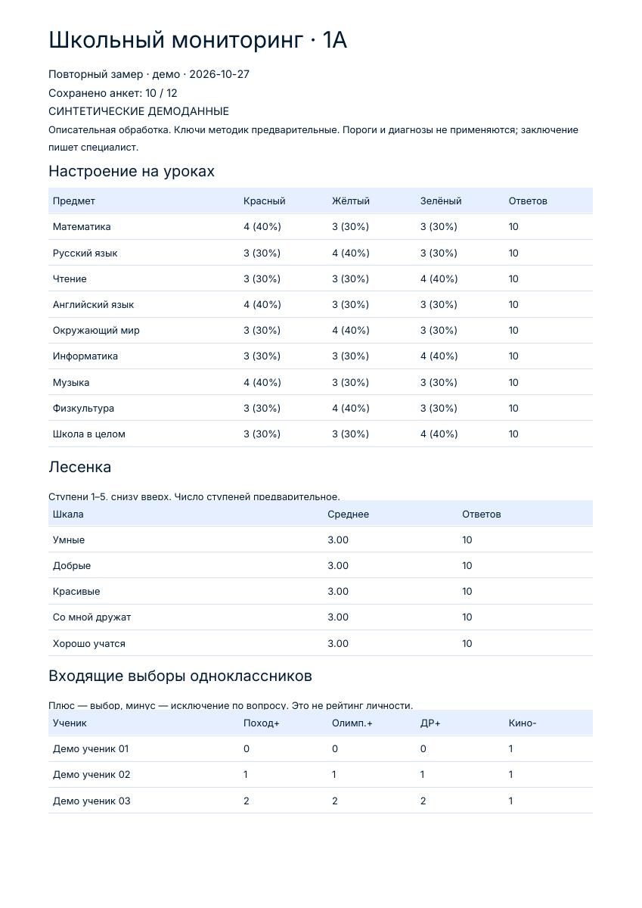

# Школьный мониторинг — Native

Отдельная нативная версия на **C++17 + wxWidgets + SQLite**, без Electron, Chromium, Node.js, .NET и WebView. Один сотрудник, локальные файлы, работа без интернета.

Исходная [Electron-версия](https://github.com/pepelaz1/school-monitor-desktop) сохранена отдельно. Новый интерфейс использует настоящие настольные элементы управления; синий цвет и шрифт Inter сохранены, но это не пиксельная копия HTML-интерфейса.



[Анкета](docs/native-questionnaire.png) · [Матрица](docs/native-matrix.png) · [Динамика](docs/native-history.png) · [Диалог](docs/native-dialog.png)

## Оформление 0.1.2

Перенесены Inter из исходного Electron-приложения, палитра `#005bff` / `#001a34`, белые карточки с рамками, радиусом 10 и мягкой тенью. Основные кнопки синие, дополнительные белые; состояния наведения, нажатия, фокуса и недоступности рисуются одинаково на Mac и Windows. Кнопки сохраняют нативные события, управление с клавиатуры и доступные названия. Пункты меню подсвечиваются при наведении и выборе. На Mac графики сглаживаются средствами wxWidgets; в Windows используется нативный GDI для устойчивой работы встроенного Inter.

Inter — тот же открытый шрифт, который использовался в Electron-версии; это не заявление об использовании фирменного шрифта Ozon. Выпадающие списки, календарь и файловые диалоги остаются системными: их внешний вид зависит от ОС. Нативное приложение сохраняет небольшой размер.

## Возможности

- Классы, ученики (имя или код, параллель 1–4), обследования с датами.
- Настроение по девяти предметам/вопросам, пять шкал «лесенки», выборы одноклассников. Пропуски не превращаются в нули.
- Отдельные социометрические вопросы для 1 и 2–4 классов. Проверяются самовыбор, чужой класс, дубликаты и противоречащие выборы.
- Количество и доли цветов, средние ступени с числом ответов, матрицы по отдельным вопросам, входящие/исходящие связи и взаимные пары.
- Сравнение обследований с учётом числа ответивших; текущий состав класса используется и для прошлых дат.
- Настоящий PDF A4 с таблицами, кириллицей и встроенным шрифтом, CSV с BOM для Excel, резервная копия SQLite.
- Новая пустая рабочая база, открытие существующей базы/копии и запоминание последнего файла. Создание базы и копии не заменяет существующий файл.
- 48 вымышленных учеников, четыре класса, два периода для демонстрации.
- Совместимый формат баз **Electron 0.1–0.2** (`meta`, `students`, `waves`, `answers` с JSON-ответами). Перед открытием одного файла закройте другую версию приложения.

## Windows 11 x64 — распаковать и запустить

В [релизе 0.1.2](https://github.com/pepelaz1/school-monitor-native/releases/tag/v0.1.2) опубликован ZIP с `SchoolMonitor.exe`, инструкцией и текстами лицензий. Библиотеки wxWidgets, SQLite, C/C++ runtime и шрифт встраиваются в EXE. Внешние DLL, установка фреймворков и доступ в интернет для работы не нужны. Windows API использует обычные системные DLL.

При запуске приложение создаёт локальный каталог данных пользователя и извлекает туда шрифт для регистрации в текущем процессе. Демобаза хранится там же. Рабочую базу можно создать в выбранной папке. Поэтому один EXE — способ распространения, а не хранение всех пользовательских данных внутри исполняемого файла.

База, PDF, CSV и копии не шифруются приложением. Сохраняйте их в защищённом месте. Сертификаты Authenticode и Apple Developer ID/нотариализация не настроены.

## Размер готовых сборок

| Windows x64 | Electron 0.2 | C++ / wxWidgets 0.1 |
|---|---:|---:|
| ZIP | около 164 МиБ | **5,29 МиБ** |
| EXE | около 238 МиБ | **13,38 МиБ** |

Нативный Windows-архив примерно в 31 раз меньше. ZIP содержит один EXE, инструкцию и лицензии. Проверена целостность ZIP и отсутствие внешних DLL. [Скачать Windows ZIP](https://github.com/pepelaz1/school-monitor-native/releases/download/v0.1.2/SchoolMonitor-Native-0.1.2-win11-x64.zip).

Также собрана macOS Apple Silicon версия (ZIP около 3 МиБ). Опубликованная Mac-сборка требует **macOS 26+**, поскольку собрана текущим SDK с этим deployment target. Для более старой macOS потребуется отдельная сборка с подходящим `CMAKE_OSX_DEPLOYMENT_TARGET`. Упаковка Mac: `scripts/package-mac.sh`.

## Правила обработки

Правила **предварительные и описательные**, полные нормативные ключи не предоставлены. Заключение и рекомендации пишет специалист. Приложение не ставит диагнозы, не присваивает детям категории и не принимает решений об их обучении.

- Настроение: красный — чаще плохое; жёлтый — хорошее, но не люблю отвечать; зелёный — отличное, люблю отвечать. Доли считаются среди заполненных ответов по конкретному вопросу. Для 1 класса общий школьный вопрос относится к понедельнику.
- Лесенка: ступени от 1 снизу до N сверху. **N=5 — демонстрационное допущение**; число ступеней 3–10 меняется только до появления ответов. Средние не превращаются в «низкий/высокий» уровень.
- 1 класс: до двух выборов для похода, олимпиады и дня рождения; один в вопросе о нехватке билета в кино. 2–4 классы: до двух положительных и отрицательных выборов для каждого из трёх вопросов.
- Социометрия считается отдельно по каждому вопросу. Взаимная пара учитывается один раз. В PDF отображаются входящие выборы, полная матрица — в приложении.
- Динамика — независимые сводки периодов, а не парный статистический анализ. Изменение состава класса и пропуски нужно учитывать отдельно.
- «Анкета сохранена» означает наличие записи, а не заполненность всех полей. Комментарий специалиста в PDF не хранится в базе.

## Сборка

Требуются CMake 3.24+, C++17-компилятор, Windows SDK/MSVC для Windows либо Xcode Command Line Tools для Mac. wxWidgets 3.3.4 загружается CMake из официального релиза с проверкой SHA-256. SQLite 3.54.1 и nlohmann/json 3.12.0 включены в исходники. Интернет нужен при первой сборке wxWidgets, но не для работы приложения.

Windows (Developer PowerShell for VS, x64):

```powershell
cmake -S . -B build -A x64
cmake --build build --config Release --parallel 4
ctest --test-dir build -C Release --output-on-failure
.\build\Release\SchoolMonitor.exe
```

macOS:

```sh
cmake -S . -B build -DCMAKE_BUILD_TYPE=Release
cmake --build build --parallel 6
ctest --test-dir build --output-on-failure
open build/SchoolMonitor.app
```

Только ядро и тесты, без wxWidgets:

```sh
cmake -S . -B build-core -DMONITOR_BUILD_GUI=OFF -DCMAKE_BUILD_TYPE=Release
cmake --build build-core --parallel 4
ctest --test-dir build-core --output-on-failure
```

## Проверки

`monitor_tests` проверяет пропуски, классы/периоды, средние, валидацию выборов, взаимные пары, календарные даты, уникальность анкет, SQLite-сохранение и открытие копии, защиту CSV от формул и структуру PDF со встроенным шрифтом.

`SchoolMonitor --smoke-test <пустая-папка>` открывает настоящее GUI-окно, инициализирует пять страниц, экспортирует PDF/CSV и копию базы, записывает `smoke-ok.txt` либо `smoke-error.txt` и завершает работу. Используйте отдельный пустой каталог: демонстрационные файлы остаются для проверки. Windows CI запускает этот тест и проверяет зависимости EXE. CI работает на Windows Server, не на Windows 11.

## Пример PDF

Это настоящий отчёт, созданный C++-версией на вымышленных данных. Браузер в формировании PDF не участвует.



## Границы версии

Нет OCR, импорта из Excel, Word-экспорта, многопользовательских ролей, облака, редактирования прошлых составов классов, удаления/перевода учеников, автоматической диагностики и фонового резервного копирования. PDF использует встроенный Inter; символы вне BMP (например, некоторые эмодзи) заменяются вопросительным знаком, длинные имена в таблицах могут обрезаться до ширины колонки. База совместима по структуре, но разные версии приложения одновременно один файл открывать не должны.

## Лицензии

Код приложения: MIT, см. `LICENSE`. wxWidgets и его встроенные зависимости, SQLite, nlohmann/json и Inter — см. `licenses/`. Шрифт распространяется по SIL OFL. Бланки заказчика и реальные детские данные не включены.
